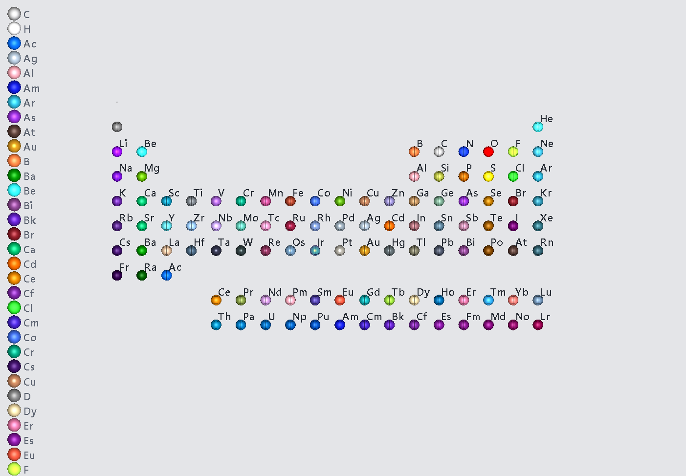
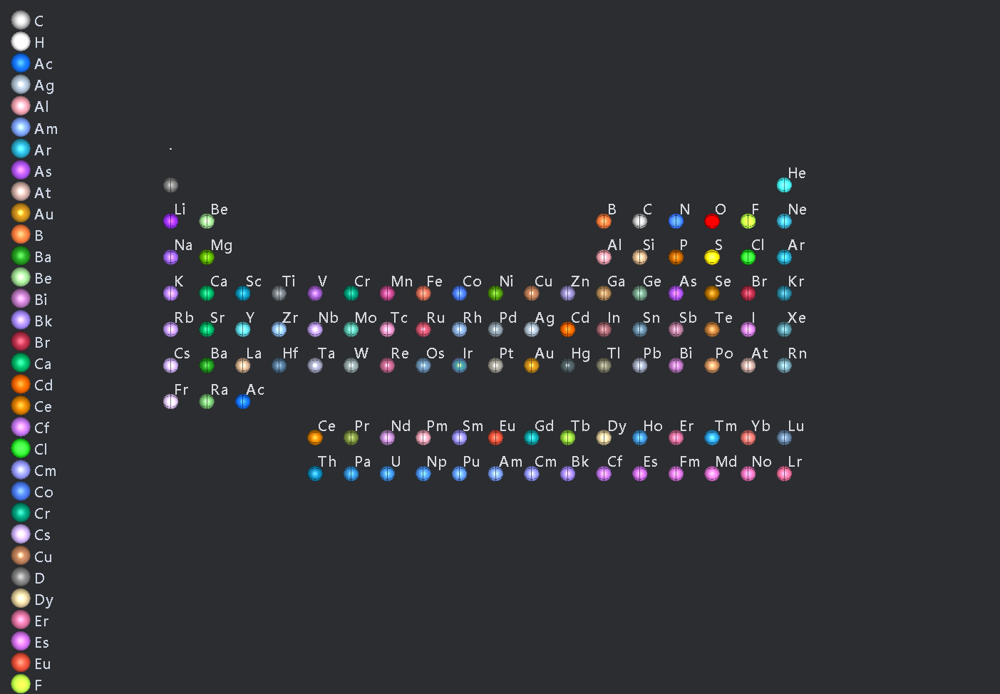
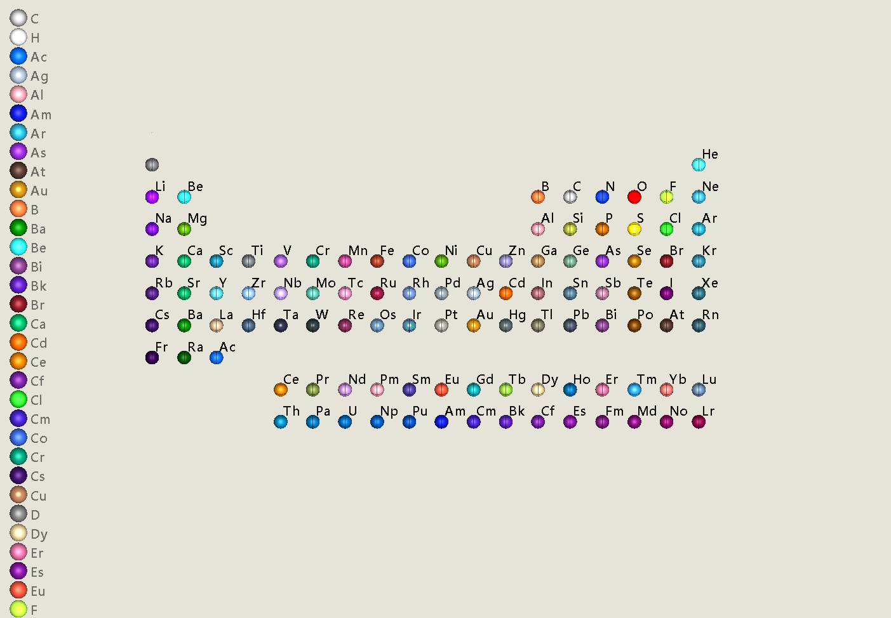
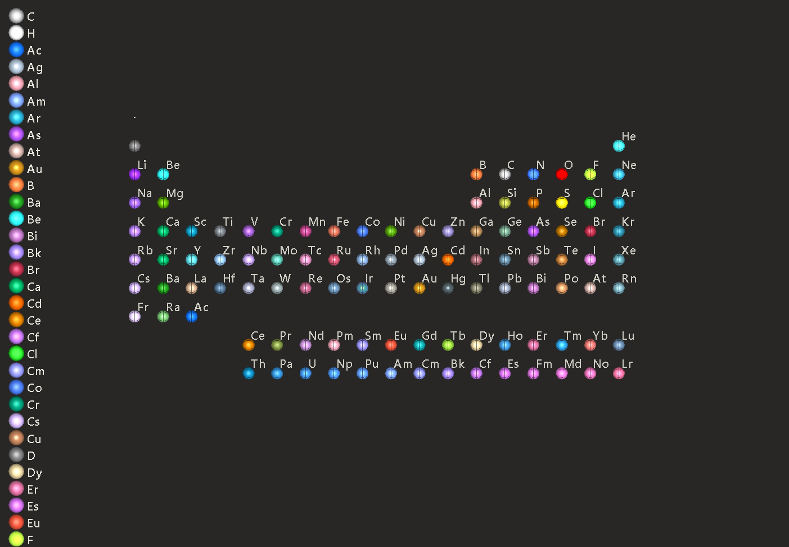
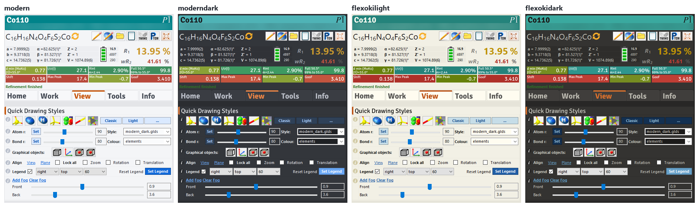
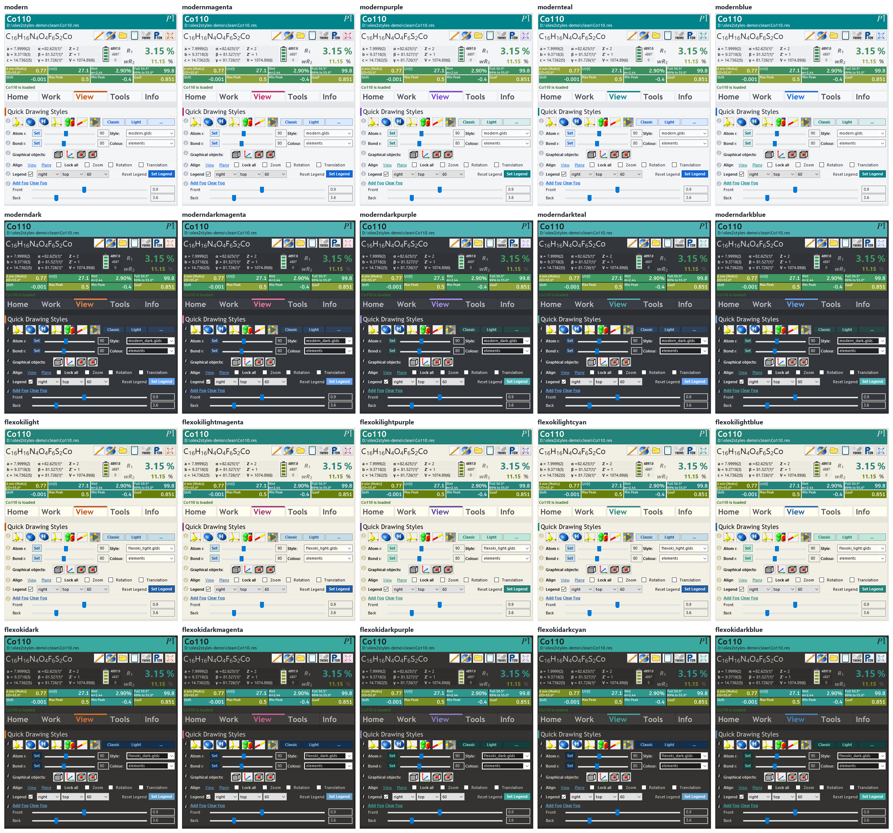

# olex2styles

Modern 3D drawing styles and GUI skins for [Olex2](https://www.olexsys.org):

- **modern**: neutral greys with vivid accents, light and dark. Featuring 
- [**Flexoki**](https://stephango.com/flexoki): Steph Ango's warm, ink-on-paper colour scheme, light and dark.


The 3D styles keep the familiar colours of the organic atoms (C, H, N, O, F, Cl, S) based on the `light_g.glsp` style and give the metals a new palette based on their chemical familiarity. 

The d-block metals, lanthanides and main-group metal colors are based on their physical appareance, chemical or physical properties while remaining distinct from each other and from the ligand atoms around them.


| modern | modern_dark |
|---|---|
|  |  |
| **flexoki_light** | **flexoki_dark** |
|  |  |

## Install

1. Copy the `etc/` folder into your Olex2 installation folder, merging it with the existing `etc/styles` and `etc/skins`.
2. In Olex2's command line, pick a skin and its matching 3D style:

   ```
   skin flexokidark
   load style flexoki_dark
   ```

_Note: When swapping skins, Olex can hides the results grid and some of the plugin tabs. `restart` solves this issue._ 


| Skins | 3D style |
|---|---|
| `modern`, `modernmagenta`, `modernpurple`, `modernteal`, `modernblue` | `modern` |
| `moderndark`, `moderndarkmagenta`, `moderndarkpurple`, `moderndarkteal`, `moderndarkblue` | `modern_dark` |
| `flexokilight`, `flexokilightmagenta`, `flexokilightpurple`, `flexokilightcyan`, `flexokilightblue` | `flexoki_light` |
| `flexokidark`, `flexokidarkmagenta`, `flexokidarkpurple`, `flexokidarkcyan`, `flexokidarkblue` | `flexoki_dark` |



The plain family name uses an orange accent, the closest to the original Olex2 look. The other names swap the accent colour:



## Regenerate

Every style and skin is generated by [`etc/styles/build_modern.py`](etc/styles/build_modern.py) from Olex2's own `light_g` style, which is included as the template. You need Python 3.8+ (standard library only); Olex2's bundled Python is not needed.

```bash
python etc/styles/build_modern.py
```

- `--finish satin|matte|glossy` sets the atom finish (default `satin`).
- `--rims dark|neutral|keep` sets the rim colours (default `dark`).
- `--report` prints colour-distance checks for the palettes and writes nothing.

To change a colour, edit the palettes in the script rather than the generated files. Then run `skin ...` and `load style ...` again: Olex2 caches the last style and keeps skin values in your user `gui.phil`.

## Known issues

Tested with Olex2 1.5 (2026.10.05) on Windows 10; only the four orange default skins have been checked inside Olex2. A few things are drawn by Olex2 or Windows and ignore the skin:

- Combo boxes, checkboxes and slider thumbs.
- The green "Refinement finished" status line.
- The white text on action buttons.
- Some graph colours.
- The font of tab and button images.

The 3D label font is Segoe UI, so other systems fall back to Olex2's default font.

## Credits and license

- **Flexoki** colour scheme by [Steph Ango](https://stephango.com/flexoki), MIT License, Copyright (c) 2023 Steph Ango.
- **Olex2** by OlexSys. `etc/styles/light_g.glds` and `light_g.glsp` are Olex2's own files, and the generated `.glds`/`.glsp` styles are derived from them; Olex2's terms (`licence.rtf` in your Olex2 installation) apply to those.
- Everything else (the generator script and the skins) is released under the [MIT License](LICENSE).
