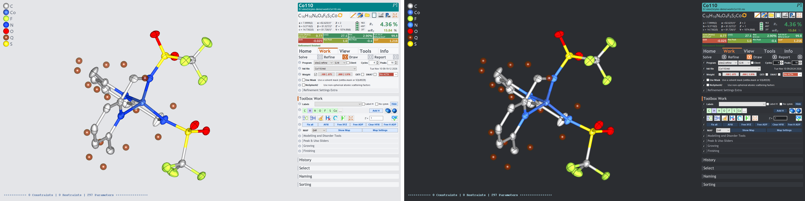

# olex2styles

Modern 3D drawing styles and GUI skins for [Olex2](https://www.olexsys.org):

- **modern**: neutral greys with vivid accents, light and dark.
- [**Flexoki**](https://stephango.com/flexoki): Steph Ango's warm, ink-on-paper colour scheme, light and dark.



## Atom colours

- Alkali and alkaline-earth metals (except Be), actinides, noble gases, H, N, O, Cl, S and the remaining non-metals (B, P, As, Se, Te) colours are taken from Olex2's `light_g`. C and F colors are modified versions of the `light_g` color: C is a bit darker so H stands out, F a little greener so it parts from S.
- Colors for most of the elements are hand-picked to resemble their physical appareance, compounds colors or their physical properties.
- The rest of the d-block and main-group metals are spread out in OKLCH, a perceptually uniform colour space. The 3d row is kept vivid, the 4d row are light pastels, the 5d row are deep tones. The dark styles lighten dark atoms so they show on the dark background.
- Colors are kept distinct by measuring their OKLab distances and nudging elements that came too close to other elements that commonly appear around them and/or to the background. Elements that share close colors (e.g.: Pd and Ag) rarely appear in the same crystal structure.

The hand-picked colours, as they appear in the light styles (the dark styles lighten the darkest ones):

| Element | Colour | Reason |
|---|---|---|
| Be | soft green `#A3E196` | Matches Mg and Ca; `light_g` gave Be the same cyan as He |
| Fe | rust red `#9F3C26` | Iron oxide |
| Co | cobalt blue `#3B68DB` | Cobalt blue pigment |
| Ni | green `#549F0D` | Green Ni<sup>2+</sup> salts |
| Cu | copper `#D08C63` | Copper metal |
| Ru | crimson `#A61F47` | Ruthenium red histology stain |
| Pd | cool silver `#A0B0BC` | Palladium metal |
| Ag | cool silver `#C1D4E5` | Silver metal |
| Cd | vivid orange `#F56600` | Cadmium pigments |
| Ta | blackish gunmetal `#34364D` | Tantallum metal |
| W | blackish gunmetal `#344344` | Tungsten metal |
| Os | silvery blue `#7AA3C8` | Osmium metal |
| Ir | deep indigo `#24418D` with an iridescent shine | Named after Iris, the rainbow, for its colourful salts |
| Pt | warm silver `#B8B4AA` | Platinum metal |
| Au | gold `#E39F20` | Gold metal |
| Hg | dark liquid metal `#667175` | Mercury |
| La | pearl `#D3B08F` | White La<sub>2</sub>O<sub>3</sub>; Greek *lanthanein*, "to lie hidden" |
| Ce | orange `#DB7E00` | Ceric ammonium nitrate |
| Pr | leek green `#7B9040` | Pr<sup>3+</sup> salts; Greek *prasios*, "leek green" |
| Nd | lilac `#C18ED1` | Nd<sup>3+</sup> salts, lilac in daylight |
| Pm | pink `#F0A6B6` | Pink Pm<sup>3+</sup> salts |
| Sm | indigo `#483A9A` | SmI<sub>2</sub> (Kagan's reagent); kept apart from Nd's lilac |
| Eu | red `#E85339` | Red Eu<sup>3+</sup> luminescence (~612 nm) |
| Gd | teal `#11A6AA` | Gd(III) MRI contrast agents |
| Tb | green `#94D53C` | Green Tb<sup>3+</sup> luminescence (~545 nm) |
| Dy | light sand `#E4CF9D` | Dy<sub>2</sub>O<sub>3</sub> sand |
| Ho | Stockholm blue `#0068A5` | *Holmia*, Latin for Stockholm |
| Er | rose `#DA709D` | Er<sup>3+</sup> salts |
| Tm | blue `#2EA2E5` | Blue Tm<sup>3+</sup> luminescence (~480 nm) |
| Yb | salmon red `#E97871` | Yb<sup>3+</sup> near-infrared emission |
| Lu | grey-blue `#698AA9` | *Lutetia*, Latin for Paris, and its zinc roofs |
| Si | light beige `#DBB68D` | Lighter and calmer than `light_g`'s olive |
| Br | deep red `#831922` | Liquid bromine |
| I | violet `#6D1C79` | Violet iodine vapour |

| modern | modern_dark |
|---|---|
|  |  |
| **flexoki_light** | **flexoki_dark** |
|  |  |

## Install

Copy the `etc/` folder for your system into your Olex2 installation folder, merging it with the existing `etc/styles` and `etc/skins`:

| System | Folder | Fonts |
|---|---|---|
| Windows | `win/etc/` | Trebuchet MS for the title block, tabs and section headers; Segoe UI for panel text and 3D labels |
| macOS | `macos/etc/` | Olex2's default fonts (see [Known issues](#known-issues)) |

Then, in Olex2's command line, pick a skin and its matching 3D style:

```
skin flexokidark
load style flexoki_dark
```

_Note: When swapping skins, Olex can hide the results grid and some of the plugin tabs. `restart` solves this issue._ 

| Skins | 3D style |
|---|---|
| `modern`, `modernmagenta`, `modernpurple`, `modernteal`, `modernblue` | `modern` |
| `moderndark`, `moderndarkmagenta`, `moderndarkpurple`, `moderndarkteal`, `moderndarkblue` | `modern_dark` |
| `flexokilight`, `flexokilightmagenta`, `flexokilightpurple`, `flexokilightcyan`, `flexokilightblue` | `flexoki_light` |
| `flexokidark`, `flexokidarkmagenta`, `flexokidarkpurple`, `flexokidarkcyan`, `flexokidarkblue` | `flexoki_dark` |


The plain family name uses an orange accent, the closest to the original Olex2 look. The other names swap the accent colour:


## Regenerate

Every style and skin is generated by [`build_modern.py`](build_modern.py) from Olex2's own `light_g` style (`light_g.glds`, `light_g.glsp`), which is included as the template. One run writes both `win/etc` and `macos/etc`. You need Python 3.8+ (standard library only); Olex2's bundled Python is not needed.

```bash
python build_modern.py
```

- `--finish satin|matte|glossy` sets the atom finish (default `satin`).
- `--rims dark|neutral|keep` sets the rim colours (default `dark`).
- `--report` prints colour-distance checks for the palettes and writes nothing.

To change a colour, edit the palettes in the script rather than the generated files. Then run `skin ...` and `load style ...` again: Olex2 caches the last style and keeps skin values in your user `gui.phil`.

## Known issues

Tested with Olex2 1.5 (2026.10.05) on Windows 10; only the four orange default skins have been checked inside Olex2. The macOS version has not been tested on a Mac. A few things are drawn by Olex2 or the operating system and ignore the skin:

- Combo boxes, checkboxes and slider thumbs.
- The green "Refinement finished" status line.
- The white text on action buttons.
- Some graph colours.
- The colours of the data/parameter battery (Olex2's own bright green, yellow, orange and red).
- The font of the results-grid cells and of the file path in the title block (Olex2's Signika).

### macOS fonts (help wanted)

The macOS version keeps Olex2's default fonts, because the Windows choices don't carry over and no Mac font setup has been tested:

- Segoe UI is a Windows font, so panel text and 3D labels need a Mac choice, such as the system font.
- Olex2's list of image fonts (`util/pyUtil/PyToolLib/FontInstances.py`) names Windows font files such as `trebuc.ttf`, so a skin can't reach the Mac's Trebuchet MS by name.
- The 3D label fonts are stored as Windows font strings, and the Mac equivalent is not known yet.

If you run Olex2 on a Mac and can test font settings, contributions are welcome.

## Credits and license

- **Flexoki** colour scheme by [Steph Ango](https://stephango.com/flexoki), MIT License, Copyright (c) 2023 Steph Ango.
- **Olex2** by OlexSys. `light_g.glds` and `light_g.glsp` are Olex2's own files, and the generated `.glds`/`.glsp` styles are derived from them; Olex2's terms (`licence.rtf` in your Olex2 installation) apply to those.
- Everything else (the generator script and the skins) is released under the [MIT License](LICENSE).
